# Architecture

FashionStore is a **Jakarta Servlet MVC** WAR. HTTP hits annotated servlets (Controller). Servlets load POJOs via JDBC DAOs (Model) and forward to JSP (View). There is no Spring, no REST API, and no service/business layer between controllers and DAOs.

## Package layout

```
com.fashionstore
├── controller   HttpServlet classes (@WebServlet)
├── model        Table-aligned POJOs
├── dao          DAO interfaces
├── dao.impl     JDBC implementations
└── util         DBConnection, AllDAOTest
```

Views live in `src/main/webapp/WEB-INF/views/` (not URL-addressable). Static CSS/images are under `src/main/webapp/assets/`. Welcome file `index.html` is listed in `web.xml`; app URLs are servlet mappings.

## MVC

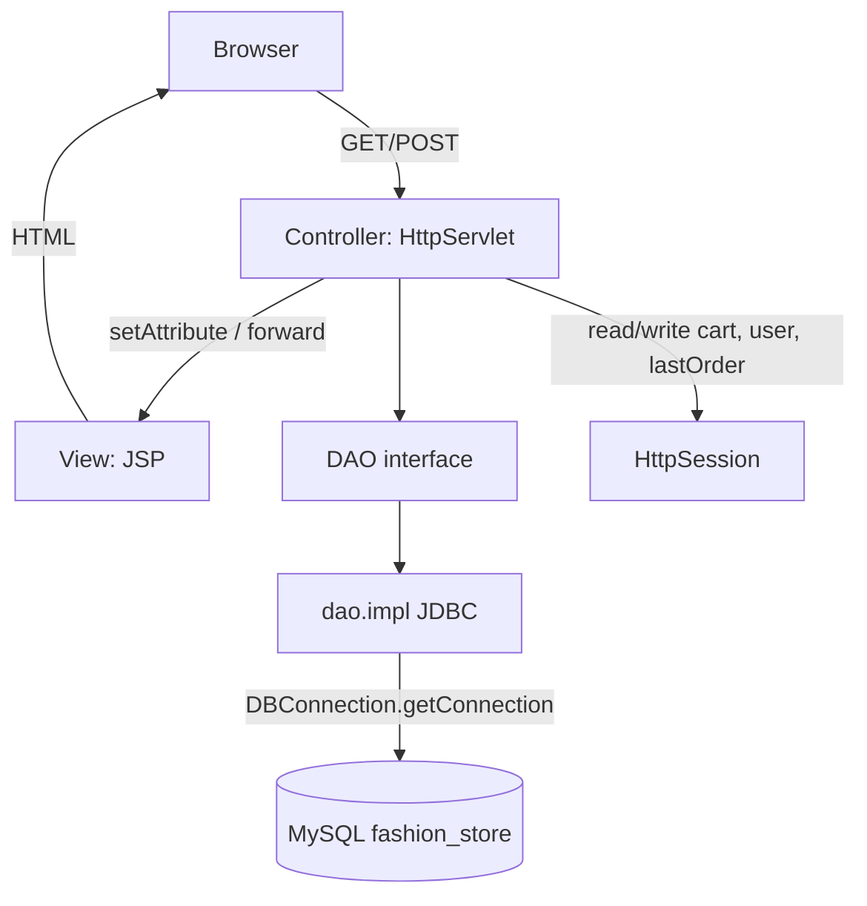

Request path:

1. Browser calls a mapped URL (`/home`, `/products`, `/cart`, …).
2. Servlet parses parameters and session.
3. Servlet calls one or more DAO methods (or only session, for cart display).
4. Servlet sets request attributes and **forwards** to a JSP, or **redirects** after a mutating POST.

Session holds: `user`, `userId`, `cart` (`Map<String, CartItem>` keyed by `productId-variantId`), `lastOrder`, `lastOrderItems`.

## Layer class diagram

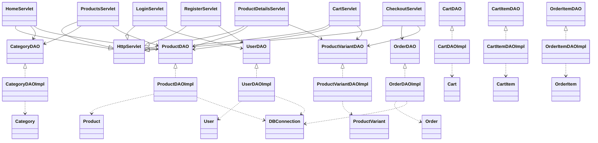

`CartDAO` / `CartItemDAO` / `OrderItemDAO` exist and are tested in `AllDAOTest`, but **no servlet currently injects them**. Live cart is session-only. Checkout writes the `orders` row only; line items stay in session as `lastOrderItems`.

## Domain class diagram

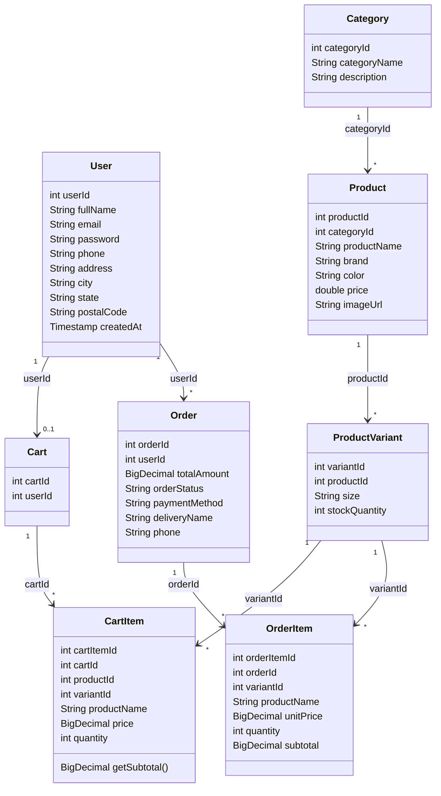

`CartItem` used by the UI also carries display fields (`productName`, `brand`, `imageUrl`, `size`, `price`) that are **not** columns on `cart_items`. Those come from `Product` + `ProductVariant` when adding to the session cart.

---

## Sequence diagrams (live flows)

### Home — `GET /home`

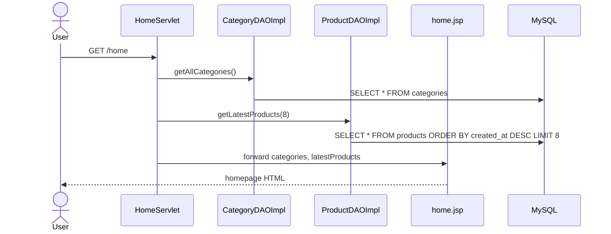

### Catalog — `GET /products`

Query params: `keyword`, `categoryId`, `minPrice`, `maxPrice`, `sortBy`. Brand/color/size filters exist on the DAO but the servlet always passes `null` for those. Pagination is hard-coded to page 1, size 100.

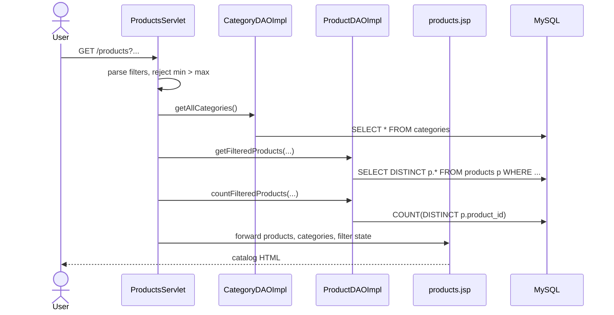

Navbar search is the same servlet: `GET /products?keyword=...`.

### Product details — `GET /product?id=`

```mermaid
sequenceDiagram
    actor User
    participant ProductDetailsServlet
    participant ProductDAOImpl
    participant ProductVariantDAOImpl
    participant details as product-details.jsp
    participant DB as MySQL

    User->>ProductDetailsServlet: GET /product?id={id}
    alt missing id
        ProductDetailsServlet-->>User: redirect /products
    else invalid id
        ProductDetailsServlet-->>User: 400
    else product missing
        ProductDetailsServlet->>ProductDAOImpl: getProductById
        ProductDAOImpl->>DB: SELECT * FROM products WHERE product_id=?
        ProductDetailsServlet-->>User: 404
    else found
        ProductDetailsServlet->>ProductDAOImpl: getProductById
        ProductDAOImpl->>DB: SELECT * FROM products WHERE product_id=?
        ProductDetailsServlet->>ProductVariantDAOImpl: getVariantsByProductId
        ProductVariantDAOImpl->>DB: SELECT * FROM product_variants WHERE product_id=?
        ProductDetailsServlet->>details: forward product, variants
        details-->>User: details + size picker
    end
```

`getRelatedProducts` is on `ProductDAO` but is **not** called here.

### Register — `GET/POST /register`

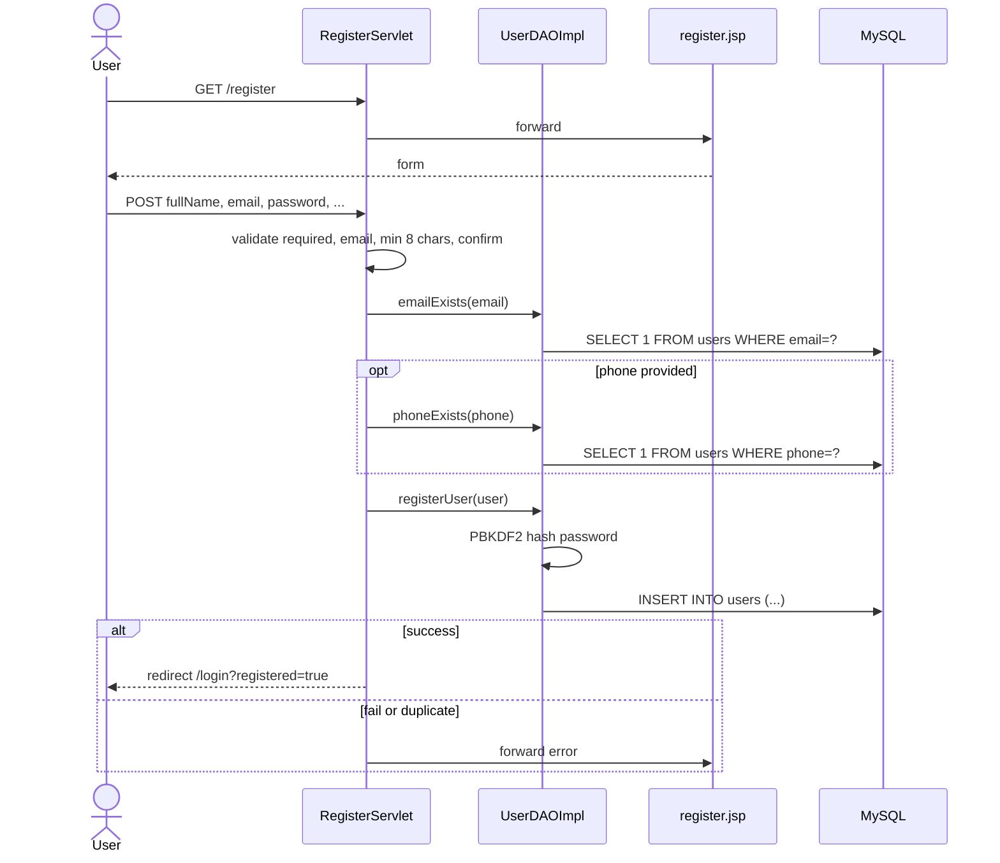

### Login — `GET/POST /login`

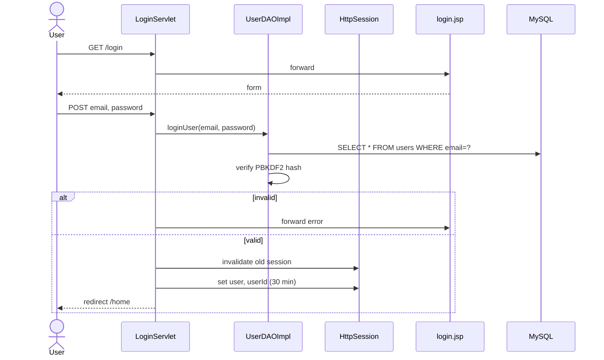

There is **no logout servlet**. Navbar always links to `/login`.

### View cart — `GET /cart`

No DAO. Cart is a `LinkedHashMap` in session.

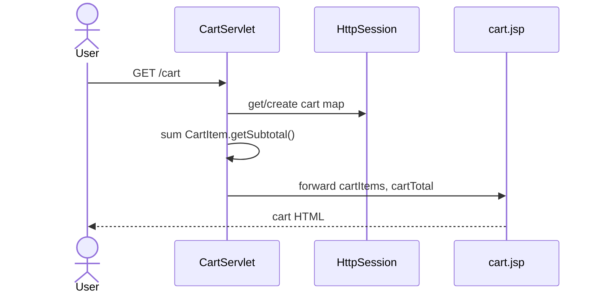

### Add to cart — `POST /cart` `action=add`

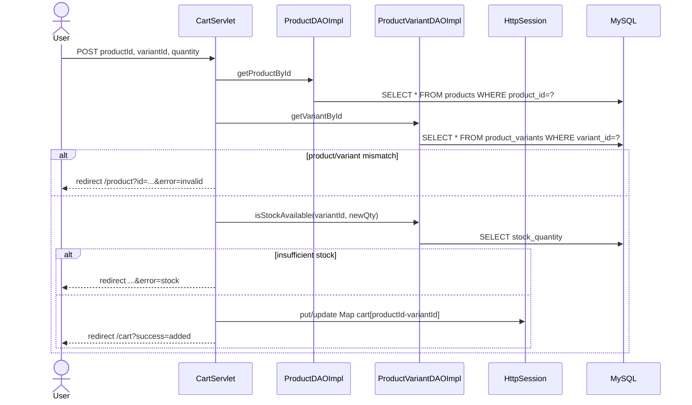

### Update quantity — `POST /cart` `action=update`

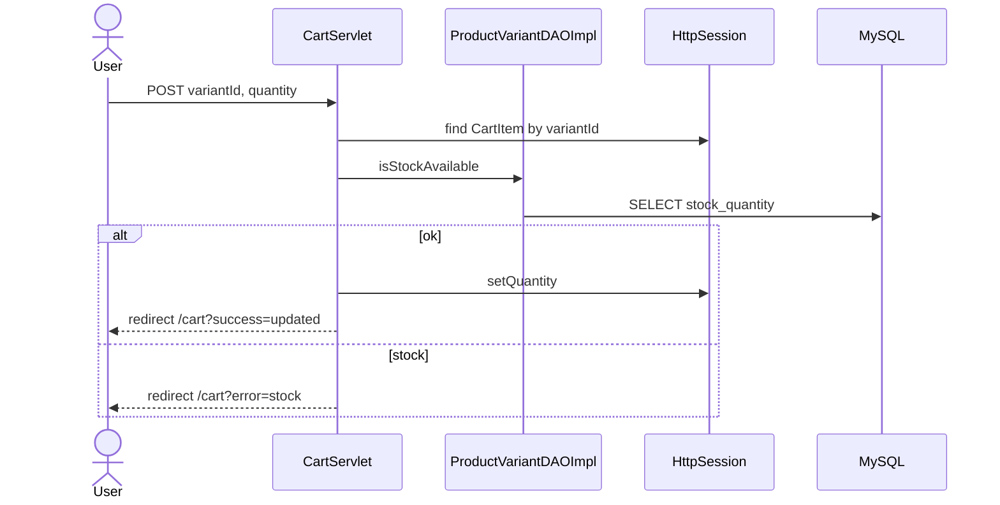

### Remove line — `POST /cart` `action=remove`

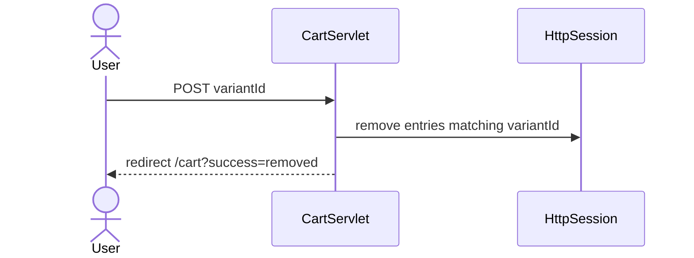

Stock is **checked**, never decremented, on add/update.

### Checkout form — `GET /checkout`

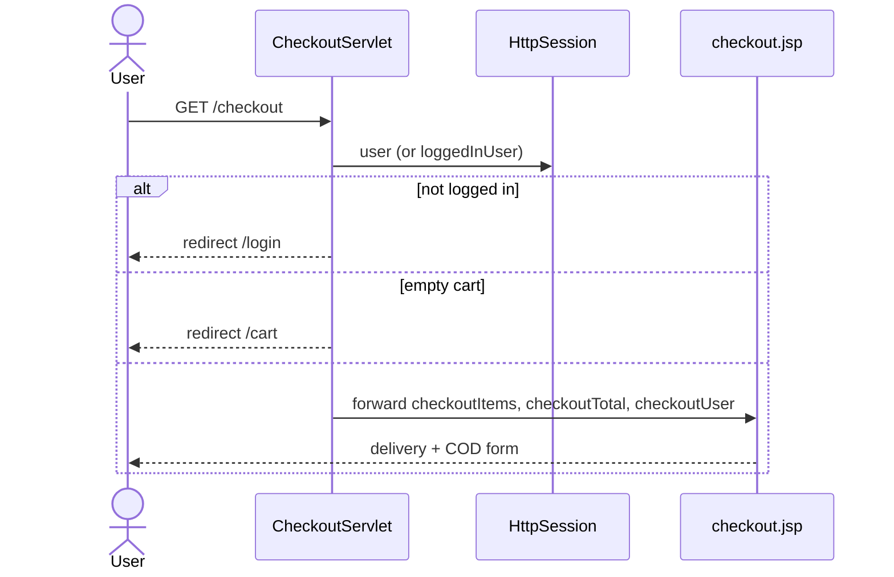

### Place order — `POST /checkout`

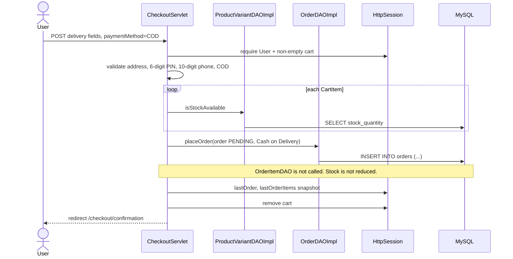

### Confirmation — `GET /checkout/confirmation`

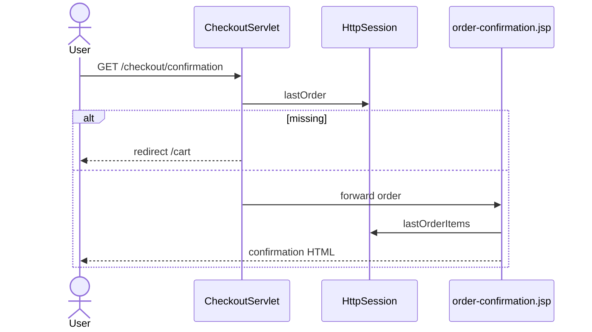

---

## URL → view

| URL | Servlet | View |
|---|---|---|
| `GET /home` | `HomeServlet` | `home.jsp` |
| `GET /products` | `ProductsServlet` | `products.jsp` |
| `GET /product` | `ProductDetailsServlet` | `product-details.jsp` |
| `GET/POST /login` | `LoginServlet` | `login.jsp` |
| `GET/POST /register` | `RegisterServlet` | `register.jsp` |
| `GET/POST /cart` | `CartServlet` | `cart.jsp` |
| `GET/POST /checkout` | `CheckoutServlet` | `checkout.jsp` |
| `GET /checkout/confirmation` | `CheckoutServlet` | `order-confirmation.jsp` |

Shared fragments: `partials/navbar.jsp`, `partials/footer.jsp`.
