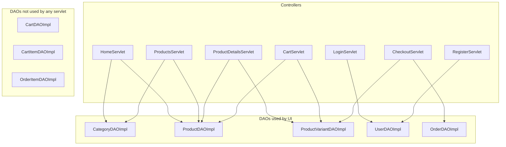
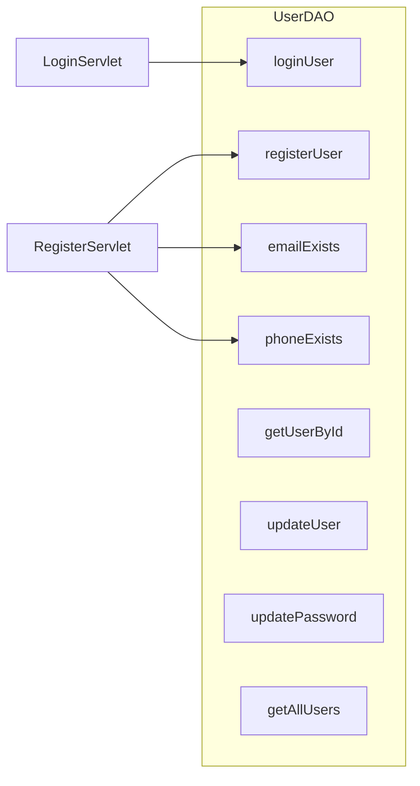
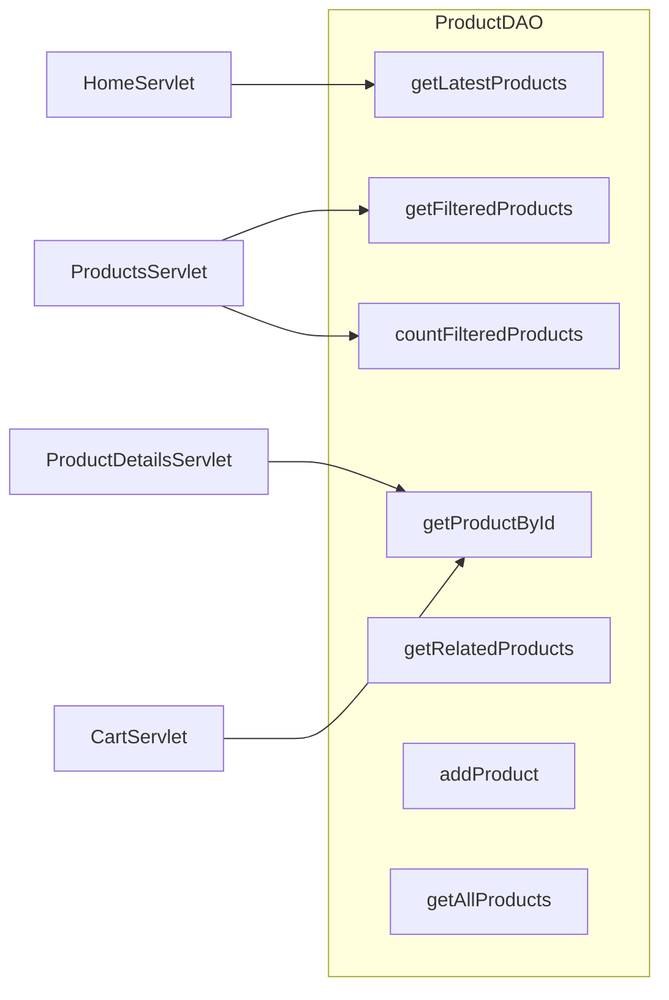
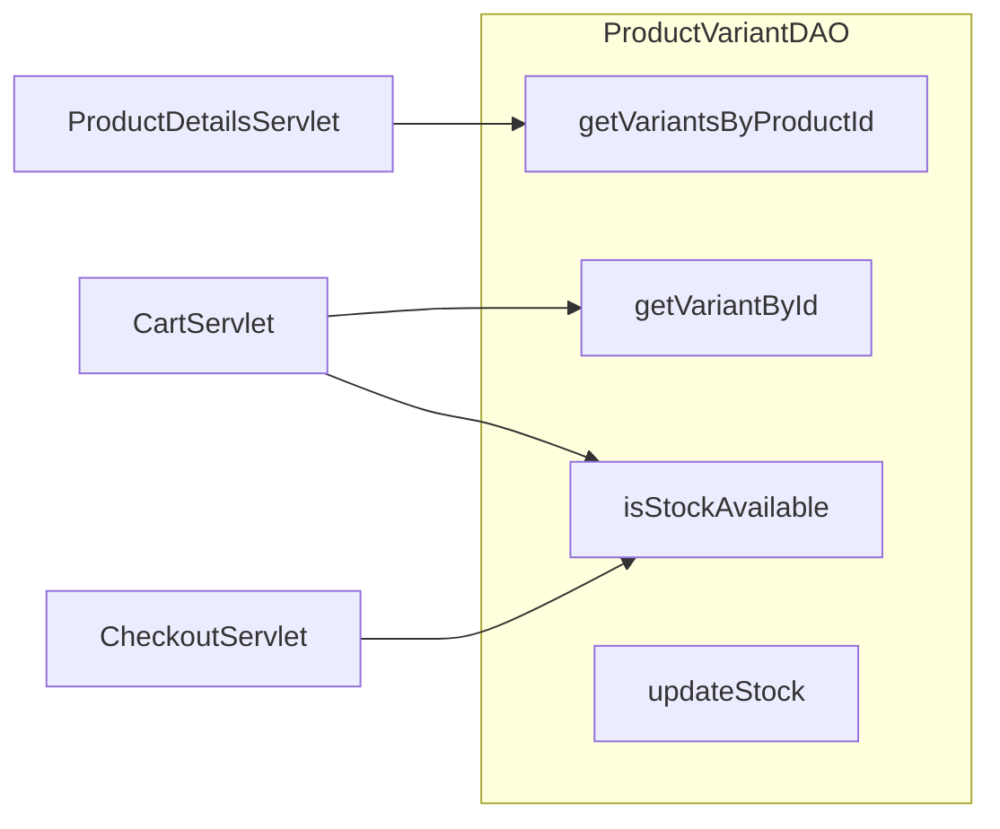

# Controllers and DAO usage

Servlets hold DAO fields as interfaces and construct `*DAOImpl` in `init()` or as instance fields. There is no factory, Spring, or service class.

## Wiring diagram

## URL map

| Mapping | Class | Methods |
|---|---|---|
| `/home` | `HomeServlet` | GET |
| `/products` | `ProductsServlet` | GET |
| `/product` | `ProductDetailsServlet` | GET |
| `/login` | `LoginServlet` | GET, POST |
| `/register` | `RegisterServlet` | GET, POST |
| `/cart` | `CartServlet` | GET, POST (`action` = add / update / remove) |
| `/checkout`, `/checkout/confirmation` | `CheckoutServlet` | GET, POST |

Mappings come from `@WebServlet`, not `web.xml`.

---

## `HomeServlet`

**DAOs:** `CategoryDAO`, `ProductDAO`

| Method | DAO call |
|---|---|
| `GET` | `categoryDAO.getAllCategories()` |
| `GET` | `productDAO.getLatestProducts(8)` |

Attributes: `categories`, `latestProducts` → `home.jsp`.

## `ProductsServlet`

**DAOs:** `ProductDAO`, `CategoryDAO`

| Method | DAO call |
|---|---|
| `GET` | `categoryDAO.getAllCategories()` |
| `GET` | `productDAO.getFilteredProducts(keyword, categoryId, min, max, null, null, null, sortBy, "ASC", 1, 100)` |
| `GET` | `productDAO.countFilteredProducts(keyword, categoryId, min, max, null, null, null)` |

Unused DAO surface from this servlet: brand/color/size filters, other sort helpers, `getProductsByPage`.

## `ProductDetailsServlet`

**DAOs:** `ProductDAO`, `ProductVariantDAO`

| Method | DAO call |
|---|---|
| `GET` | `productDAO.getProductById(id)` |
| `GET` | `productVariantDAO.getVariantsByProductId(id)` |

Redirects to `/products` if `id` is missing. 404 if product is null. Does not call `getRelatedProducts`.

## `LoginServlet`

**DAOs:** `UserDAO`

| Method | DAO call |
|---|---|
| `GET` | none |
| `POST` | `userDAO.loginUser(email, password)` |

Session after success: `user` (`User`), `userId` (`int`). Old session invalidated first.

`CheckoutServlet` also accepts `loggedInUser`; login never sets that name.

## `RegisterServlet`

**DAOs:** `UserDAO`

| Method | DAO call |
|---|---|
| `GET` | none |
| `POST` | `userDAO.emailExists(email)` |
| `POST` | `userDAO.phoneExists(phone)` if phone non-blank |
| `POST` | `userDAO.registerUser(user)` |

Does not auto-login. Redirects to `/login?registered=true`.

## `CartServlet`

**DAOs:** `ProductDAO`, `ProductVariantDAO`  
**Not used:** `CartDAO`, `CartItemDAO`

| Method | DAO call | Storage |
|---|---|---|
| `GET` | none | session `cart` |
| `POST add` | `productDAO.getProductById` | session |
| `POST add` | `variantDAO.getVariantById` | session |
| `POST add` | `variantDAO.isStockAvailable` | session |
| `POST update` | `variantDAO.isStockAvailable` | session |
| `POST remove` | none | session |

Cart key: `productId + "-" + variantId`. Guest carts work (no login required).

## `CheckoutServlet`

**DAOs:** `OrderDAO`, `ProductVariantDAO`  
**Not used:** `OrderItemDAO`, `UserDAO`, `CartDAO`

| Method | Path | DAO call |
|---|---|---|
| `GET` | `/checkout` | none (session user + cart) |
| `GET` | `/checkout/confirmation` | none (`lastOrder`) |
| `POST` | `/checkout` | `variantDAO.isStockAvailable` per line |
| `POST` | `/checkout` | `orderDAO.placeOrder(order)` |

Gate: must have session `user` or `loggedInUser`. Payment must be `COD` (stored as `"Cash on Delivery"`). Status written as `"PENDING"`.

After success: `lastOrder`, `lastOrderItems` (copy of session cart), then `cart` removed. No insert into `order_items`, no `updateStock`.

---

## DAO methods vs servlet callers

Methods with **no servlet caller** (available for admin/tests): `UserDAO` get/update/list; `CategoryDAO` add/update/delete/getById; most `ProductDAO` CRUD/sort helpers; `ProductVariantDAO` CRUD/`updateStock`; entire `CartDAO`, `CartItemDAO`, `OrderItemDAO`; `OrderDAO` get/list/status/cancel.

## Session contract (not a table)

| Attribute | Set by | Read by |
|---|---|---|
| `user` | `LoginServlet` | `CheckoutServlet`, JSPs |
| `userId` | `LoginServlet` | unused by other servlets |
| `cart` | `CartServlet` | `CartServlet`, `CheckoutServlet`, `navbar.jsp` |
| `lastOrder` | `CheckoutServlet` POST | confirmation GET + JSP |
| `lastOrderItems` | `CheckoutServlet` POST | `order-confirmation.jsp` |

## Gaps the team should treat as current design, not accidents

1. DB cart tables are implemented; UI cart is session-only (lost on timeout/new device; not tied to `users`).
2. Checkout persists order header only; line items live in session until the browser session ends.
3. Stock is validated, never reduced.
4. No logout, no order-history servlet, no admin product/category UI.
