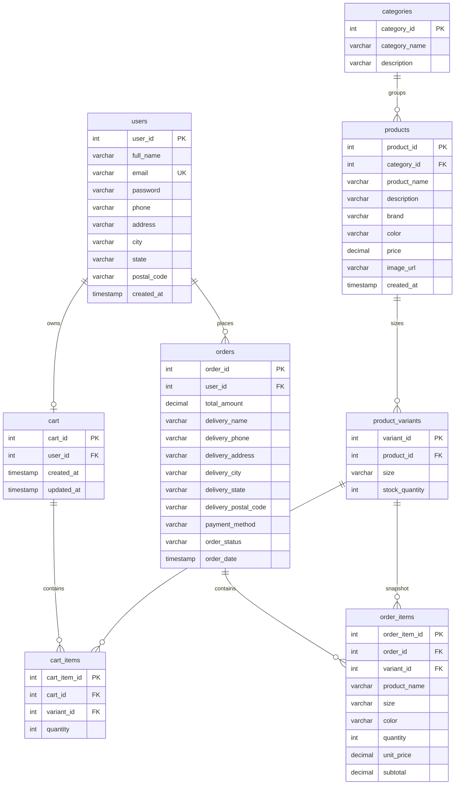
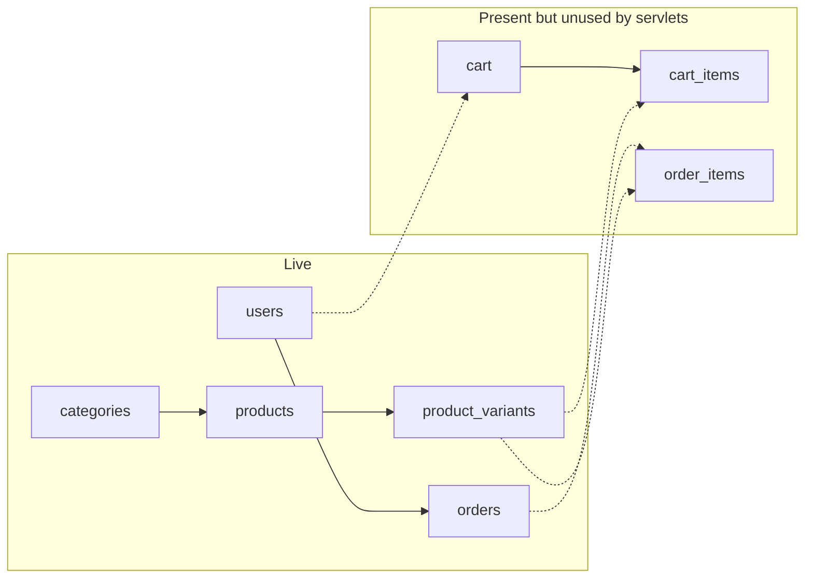
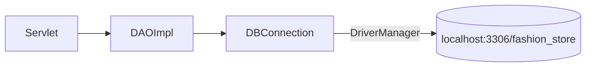

# Database

MySQL schema **`fashion_store`** (JDBC URL in `DBConnection`: `jdbc:mysql://localhost:3306/fashion_store`). Access is raw JDBC via `PreparedStatement`; no JPA/Hibernate.

Column lists below come from INSERT/SELECT/map methods in `dao.impl`. Types are the Java types the DAOs bind.

## ER diagram



Implied uniqueness from DAO lookups: `users.email`, `users.phone`, `cart.user_id` (one cart per user), `product_variants (product_id, size)`.

---

## Table → class → DAO

| Table | Model | Interface | Implementation | Used by live UI |
|---|---|---|---|---|
| `users` | `User` | `UserDAO` | `UserDAOImpl` | Login, Register |
| `categories` | `Category` | `CategoryDAO` | `CategoryDAOImpl` | Home, Products |
| `products` | `Product` | `ProductDAO` | `ProductDAOImpl` | Home, Products, Details, Cart |
| `product_variants` | `ProductVariant` | `ProductVariantDAO` | `ProductVariantDAOImpl` | Details, Cart, Checkout |
| `cart` | `Cart` | `CartDAO` | `CartDAOImpl` | No (test only) |
| `cart_items` | `CartItem` | `CartItemDAO` | `CartItemDAOImpl` | No (test only) |
| `orders` | `Order` | `OrderDAO` | `OrderDAOImpl` | Checkout POST |
| `order_items` | `OrderItem` | `OrderItemDAO` | `OrderItemDAOImpl` | No (test only) |

UI cart lines are `CartItem` objects in **session**, not rows in `cart_items`.



---

## `users` → `User` / `UserDAOImpl`

| Column | Java field | Notes |
|---|---|---|
| `user_id` | `userId` | Generated key on register |
| `full_name` | `fullName` | |
| `email` | `email` | Lookup + uniqueness check |
| `password` | `password` | Stored as `iterations:salt:hash` (PBKDF2-HMAC-SHA256). Mapper sets `password` to `null` after load |
| `phone` | `phone` | Optional uniqueness check |
| `address` | `address` | |
| `city` | `city` | |
| `state` | `state` | |
| `postal_code` | `postalCode` | |
| `created_at` | `createdAt` | Read only; not in INSERT list (DB default) |

DAO writes: `registerUser`, `updateUser`, `updatePassword`. Reads: `loginUser`, `getUserById/Email/Phone`, `getAllUsers`, `emailExists`, `phoneExists`.

## `categories` → `Category` / `CategoryDAOImpl`

| Column | Java field |
|---|---|
| `category_id` | `categoryId` |
| `category_name` | `categoryName` |
| `description` | `description` |

Home and catalog only call `getAllCategories()`. Add/update/delete exist on the DAO but have no admin UI.

## `products` → `Product` / `ProductDAOImpl`

| Column | Java field |
|---|---|
| `product_id` | `productId` |
| `category_id` | `categoryId` |
| `product_name` | `productName` |
| `description` | `description` |
| `brand` | `brand` |
| `color` | `color` |
| `price` | `price` (`double` in model; `BigDecimal` in JDBC) |
| `image_url` | `imageUrl` |
| `created_at` | `createdAt` |

`getAllActiveProducts()` is an alias of `getAllProducts()` — there is no status column.

Size filter joins `product_variants` (`JOIN product_variants v ON p.product_id = v.product_id`).

## `product_variants` → `ProductVariant` / `ProductVariantDAOImpl`

| Column | Java field |
|---|---|
| `variant_id` | `variantId` |
| `product_id` | `productId` |
| `size` | `size` |
| `stock_quantity` | `stockQuantity` |

`isStockAvailable` compares `stock_quantity >= requiredQuantity`. `updateStock` exists but checkout never calls it.

## `cart` → `Cart` / `CartDAOImpl`

| Column | Java field |
|---|---|
| `cart_id` | `cartId` |
| `user_id` | `userId` |
| `created_at` | `createdAt` |
| `updated_at` | `updatedAt` |

INSERT only sets `user_id`. One cart per user via `getCartByUserId` / `getOrCreateCartByUserId`.

## `cart_items` → `CartItem` / `CartItemDAOImpl`

Persisted columns:

| Column | Java field |
|---|---|
| `cart_item_id` | `cartItemId` |
| `cart_id` | `cartId` |
| `variant_id` | `variantId` |
| `quantity` | `quantity` |

Not stored on this table (UI/session only): `productId`, `productName`, `brand`, `imageUrl`, `size`, `price`. Cart total SQL joins variants → products:

```text
cart_items → product_variants → products.price
```

## `orders` → `Order` / `OrderDAOImpl`

| Column | Java field |
|---|---|
| `order_id` | `orderId` |
| `user_id` | `userId` |
| `total_amount` | `totalAmount` |
| `delivery_name` | `deliveryName` |
| `delivery_phone` | `phone` (`getDeliveryPhone` / `setDeliveryPhone` alias) |
| `delivery_address` | `deliveryAddress` |
| `delivery_city` | `deliveryCity` |
| `delivery_state` | `deliveryState` |
| `delivery_postal_code` | `deliveryPostalCode` |
| `payment_method` | `paymentMethod` | default `"COD"` if blank |
| `order_status` | `orderStatus` | default `"PLACED"` if blank; checkout sends `"PENDING"` |
| `order_date` | `orderedAt` | DB column name ≠ Java name |

`cancelOrder` sets `CANCELLED` unless already `CANCELLED` or `DELIVERED`. Status update/cancel are not wired to a servlet.

Checkout `placeOrder` does **not** write `order_items` and does not decrement stock.

## `order_items` → `OrderItem` / `OrderItemDAOImpl`

| Column | Java field |
|---|---|
| `order_item_id` | `orderItemId` |
| `order_id` | `orderId` |
| `variant_id` | `variantId` |
| `product_name` | `productName` |
| `size` | `size` |
| `color` | `color` |
| `quantity` | `quantity` |
| `unit_price` | `unitPrice` |
| `subtotal` | `subtotal` |

Name/size/color/price are copied onto the row (order snapshot), not joined at read time.

Confirmation UI reads `lastOrderItems` (`List<CartItem>` in session), not this table.

---

## Connectivity



`DBConnection` loads `com.mysql.cj.jdbc.Driver` once and opens a new connection per call. Implementations close connections with try-with-resources. No connection pool.
